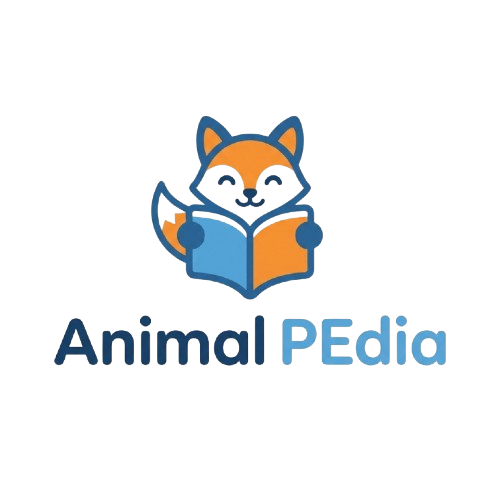

<h1 align="center" style="font-weight: bold;">Animal Pedia</h1>

<p align="center">
    
</p>

[PYTHON__BADGE]: https://img.shields.io/badge/Python-%233776AB.svg?style=for-the-badge&logo=python&logoColor=white
[DJANGO__BADGE]: https://img.shields.io/badge/Django-%23092E20.svg?style=for-the-badge&logo=django&logoColor=white
[SQLITE__BADGE]: https://img.shields.io/badge/SQLite-%2307405e.svg?style=for-the-badge&logo=sqlite&logoColor=white
[HTML__BADGE]: https://img.shields.io/badge/HTML5-%23E34F26.svg?style=for-the-badge&logo=html5&logoColor=white
[CSS__BADGE]: https://img.shields.io/badge/CSS3-%231572B6.svg?style=for-the-badge&logo=css3&logoColor=white
[JAVASCRIPT__BADGE]: https://img.shields.io/badge/Javascript-F7DF1E?style=for-the-badge&logo=javascript&logoColor=black
[SELENIUM__BADGE]: https://img.shields.io/badge/Selenium-43B02A?style=for-the-badge&logo=selenium&logoColor=white

<p align="center">
  • <a href="#technologies">Tecnologias</a> •
  <a href="#layout">Layout</a> •
  <a href="#started">Iniciando</a> •
  <a href="#routes">Funcionamento</a> •
  <a href="#tests">Testes End-to-End</a> •
  <a href="#colab">Colaboradores</a> •
  <a href="#contribute">Contribua</a>
</p>

<p align="center">
    <b>Aplicação Web em Django MVT para busca de animais e exibição de suas características (se é predador, venenoso ou doméstico), desenvolvida com foco em TDD e testes automatizados de interface com Selenium.</b>
</p>

<h2 id="layout">🎨 Layout/Preview</h2>

<p align="center">
    
    
</p>

<h2 id="technologies">💻 Tecnologias</h2>

<div>

![Python][PYTHON__BADGE]
![Django][DJANGO__BADGE]
![SQLite][SQLITE__BADGE]
![HTML5][HTML__BADGE]
![CSS3][CSS__BADGE]
![Javascript][JAVASCRIPT__BADGE]
![Selenium][SELENIUM__BADGE]

</div>

<h2 id="started">🚀 Iniciando</h2>

Siga as instruções abaixo para rodar o projeto em seu ambiente local.

<h3>Pré-requisitos</h3>

- [Python 3.8+](https://www.python.org/)
- [Git](https://git-scm.com/)
- [Google Chrome](https://www.google.com/chrome/) e [ChromeDriver](https://chromedriver.chromium.org/) (Também roda no Firefox)

<h3>Clonando</h3>

```bash
git clone https://github.com/JoaoxVictorMS/Animal_Pedia.git
cd Animal_Pedia
```

<h3>Criando e ativando o ambiente virtual</h3>

```bash
# Criar ambiente virtual
python -m venv .venv

# Ativar no Windows (PowerShell)
.\.venv\Scripts\Activate.ps1

# Ativar no Windows (Git Bash)
source .venv/Scripts/activate

# Ativar no Linux / macOS
source .venv/bin/activate
```

<h3>Instalando dependências</h3>

```bash
pip install -r requirements.txt
```

<h3>Executando migrações e popular banco de dados</h3>

```bash
# Aplicar migrações do banco
python manage.py makemigrations
python manage.py migrate

# Popular o banco de dados com a lista inicial de animais
python lista_animais.py
```

<h3>Executando a aplicação</h3>

```bash
python manage.py runserver
```

A aplicação estará disponível no navegador no endereço `http://127.0.0.1:8000/`.

<h2 id="tests">🧪 Testes Automatizados (TDD & Selenium)</h2>

O projeto possui uma suíte completa de testes automatizados unitários e End-to-End (E2E) simulando a navegação do usuário real através do **Selenium WebDriver**.

Para executar os testes:

```bash
# Executar todos os testes do Django e Selenium
python manage.py test
```

> **Nota:** Certifique-se de ter o `chromedriver` compatível com a sua versão do Google Chrome configurado nas variáveis de ambiente do sistema ou apontado corretamente no arquivo de testes.

<h2 id="routes">📍 Funcionamento da Aplicação</h2>

Como este projeto utiliza a arquitetura MVT (Model-View-Template) do Django, a interação acontece via requisições HTTP GET com parâmetros na URL.

| Rota                           | Parâmetros        | Descrição                                                                           |
| ------------------------------ | ----------------- | ----------------------------------------------------------------------------------- |
| <kbd>GET /</kbd>               | -                 | Renderiza a página inicial com o formulário de busca                                |
| <kbd>GET /?buscar={nome}</kbd> | `buscar` (string) | Filtra o banco de dados e exibe os cards com as 4 características do animal buscado |

<h3 id="search-example">Exemplo de Filtro de Busca</h3>

Ao pesquisar por **"leão"** (`GET /?buscar=leão`), a view filtra o banco de dados via `.filter(nome_animal__icontains=...)` e renderiza no template HTML:

```html
- Nome do animal: leão - Predador: Sim - Venenoso: Não - Doméstico: Não
```

<h2 id="colab">🤝 Colaboradores</h2>

Um agradecimento especial a todas as pessoas que contribuíram para este projeto.

<table>
  <tr>
    <td align="center">
      <a href="#">
        <br>
        <sub>
          <b>João Victor</b>
        </sub>
      </a>
    </td>
  </tr>
</table>

<h2 id="contribute">📫 Contribua</h2>

Para contribuir com o projeto:

1. Faça o fork do projeto
2. Crie uma nova branch com a sua funcionalidade (`git checkout -b feature/minha-feature`)
3. Faça commit das suas alterações (`git commit -m 'feat: Adiciona minha funcionalidade'`)
4. Faça o push para a branch (`git push origin feature/minha-feature`)
5. Abra um Pull Request

<h3>Documentações que podem ajudar</h3>

[📝 Como criar um Pull Request](https://www.atlassian.com/br/git/tutorials/making-a-pull-request)

[💾 Padrão de commit](https://gist.github.com/joshbuchea/6f47e86d2510bce28f8e7f42ae84c716)
